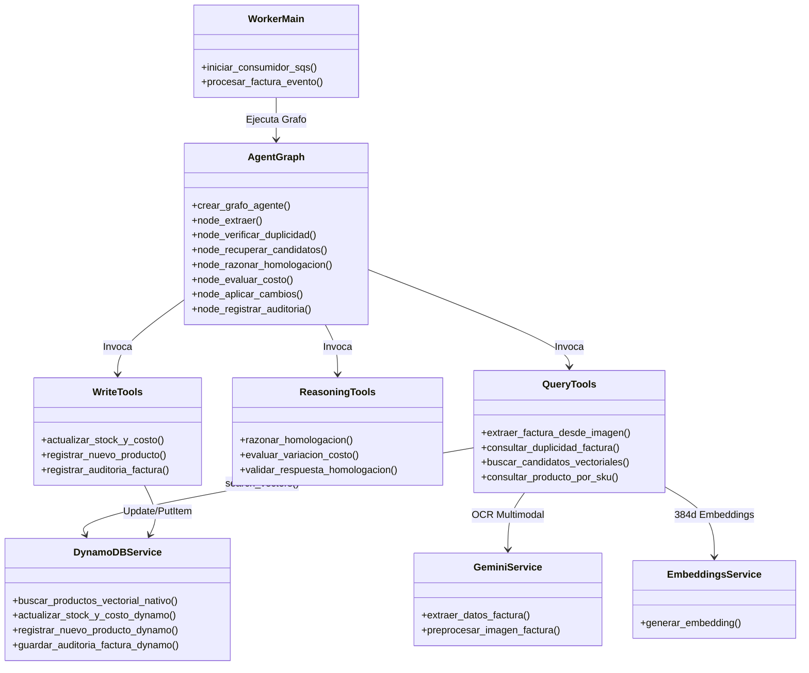

# Agente Inteligente de Homologación de Facturas e Inventario (AWS Cloud)

La aplicación incluye una sección de **Estadísticas y asistente**, con gastos por proveedor y mes, exportación CSV y revisión de encabezados históricos sin modificar stock. Ver [configuración, reglas y pruebas](docs/ESTADISTICAS.md).

Sistema de inteligencia artificial distribuido, escalable y resiliente desarrollado bajo una **Arquitectura de Microservicios Orientada a Eventos (Event-Driven)** en **Amazon Web Services (AWS)**. Automatiza la ingesta, extracción multimodal, homologación semántica con **Búsqueda Vectorial Nativa en Amazon DynamoDB** y actualización transaccional del inventario de botillerías a partir de facturas de distribuidores de licores en Chile.

---

## 1. Problema de Negocio y Solución Arquitectónica

En las botillerías y comercializadoras de licores chilenas, las facturas mayoristas presentan glosas informales con abreviaturas complejas (ej. `"mst 35 750"`, `"cerv cor 355 pack6"`, `"pis cap 30"`), formatos por bulto/pack y alzas de precios imprevistas.

* **El Problema del Monolito:** En arquitecturas monolíticas previas, la ingesta HTTP y el cómputo pesado de inferencia de IA (OCR con Gemini, embeddings y LangGraph) competían por el mismo proceso, provocando saturación de memoria, hilos bloqueados y caídas por *HTTP Gateway Timeout* (504).
* **Nuestra Solución en AWS:**
  * **Microservicio API (`api/`):** Ligero, I/O Bound (~100-120 MB RAM), expone `/health` y `POST /facturas/upload` retornando inmediatamente **HTTP 202 Accepted**.
  * **Almacenamiento de Objetos (`Amazon S3`):** Almacena las imágenes crudas de las facturas de forma durable y segura.
  * **Cola de Mensajería Asíncrona (`Amazon SQS`):** Desacopla la recepción del procesamiento y absorbe picos de demanda con tolerancia a fallos.
  * **Microservicio Worker (`worker/`):** Consumidor asíncrono con **Long Polling**, orquestado mediante **LangGraph**, **Búsqueda Vectorial Nativa en DynamoDB (`search_vectors`)** y diseño **Stateless** (limpieza en `/tmp/`).

---

## 2. Arquitectura General del Sistema en AWS

```mermaid
flowchart TD
    Cliente(["Cliente / Operador de Botillería"]) -->|"POST /facturas/upload<br/>GET /health"| ALB["Application Load Balancer / Ingress"]

    subgraph ECS_Cluster ["Amazon ECS Cluster (Fargate / EC2)"]
        subgraph Microservicio_API ["Microservicio API (FastAPI)"]
            C_API["Contenedor API<br/>(python:3.11-slim)<br/>~100-120 MB RAM"]
        end

        subgraph Microservicio_Worker ["Microservicio Worker (LangGraph AI)"]
            C_Worker["Contenedor Worker<br/>(python:3.11-slim)<br/>~300-380 MB RAM"]
        end
    end

    subgraph AWS_Cloud_Services ["Servicios Gestionados AWS"]
        S3[("Amazon S3 Bucket<br/>'botilleria-facturas-raw'")]
        SQS[("Amazon SQS Queue<br/>'botilleria-facturas-queue'")]
        DDB_Prod[("Amazon DynamoDB: 'botilleria-productos'<br/>• VectorIndexes (384d, COSINE)<br/>• Actualización Atómica ADD")]
        DDB_Audit[("Amazon DynamoDB: 'botilleria-historial-facturas'<br/>• Auditoría Transaccional")]
        CloudWatch[("Amazon CloudWatch Logs<br/>• Structured JSON Logging")]
    end

    subgraph AI_Inference ["Servicios Externos de Inteligencia"]
        Gemini["Google Gemini Vision API<br/>(OCR Multimodal)"]
        LLM["Groq / OpenAI API<br/>(Razonamiento Homologación)"]
    end

    ALB -->|"Petición HTTP"| C_API

    %% Flujos de Ingesta
    C_API -->|"1. PutObject (guarda imagen)"| S3
    C_API -->|"2. SendMessage (factura_id, s3_key)"| SQS
    C_API -->|"3. HTTP 202 Accepted"| Cliente

    %% Flujos del Worker
    C_Worker -->|"4. Long Polling (WaitTime=20s)"| SQS
    C_Worker -->|"5. GetObject temporal a /tmp/"| S3
    C_Worker -->|"6. Percepción Multimodal"| Gemini
    C_Worker -->|"7. Búsqueda vectorial nativa: search_vectors()"| DDB_Prod
    C_Worker -->|"8. Razonamiento semántico con Pydantic"| LLM
    C_Worker -->|"9. Actualización atómica de stock"| DDB_Prod
    C_Worker -->|"10. Registro de auditoría"| DDB_Audit
    C_Worker -->|"11. Borrado de archivo en /tmp/ (Stateless)"| C_Worker
    C_Worker -->|"12. delete_message() tras éxito (ACK)"| SQS

    %% Trazabilidad
    C_API -.->|"Métricas y errores"| CloudWatch
    C_Worker -.->|"Tiempos de ejecución"| CloudWatch
```



---

## 3. Justificación de Patrones Arquitectónicos

### Patrón 1: Arquitectura de Microservicios
* **Separación Estricta de Cómputo:** El servicio `api/main.py` no importa ninguna librería de IA (`langgraph`, `gemini`, `sentence-transformers`). Su único propósito es la ingesta segura y rápida.
* **Escalado Asimétrico:** La API puede escalar a decenas de réplicas en segundos con un consumo despreciable de memoria, mientras que los Workers escalan independientemente según la profundidad de la cola SQS (`ApproximateNumberOfMessagesVisible`).

### Patrón 2: Arquitectura Orientada a Eventos (Event-Driven con SQS y S3)
* **Desacoplamiento Temporal (HTTP 202 Accepted):** El cliente recibe de inmediato su identificador de seguimiento `factura_id` sin esperar los 15-30 segundos que demora el análisis multimodal y semántico.
* **Tolerancia a Fallos y ACK Diferido:** El Worker realiza **Long Polling** (`WaitTimeSeconds=20`). El mensaje no se elimina de la cola hasta que el grafo de LangGraph finaliza completamente. Si un contenedor se detiene a mitad del proceso, el *Visibility Timeout* expira y otra réplica retoma el procesamiento sin pérdida de datos.

### Patrón 3: Búsqueda Vectorial Nativa en Amazon DynamoDB
* **Sin clústeres externos:** Aprovecha la capacidad oficial de **Vector Search en DynamoDB** (Disponibilidad General, 5 de agosto de 2026).
* Al crear la tabla `botilleria-productos`, se define el bloque `VectorIndexes`:
  ```python
  VectorIndexes=[{
      "IndexName": "ProductosVectorIndex",
      "VectorAttribute": {"AttributeName": "embedding"},
      "Dimensions": 384,
      "DistanceFunction": "COSINE",
      "Projection": {"ProjectionType": "ALL"}
  }]
  ```
* La búsqueda se realiza directamente en la nube de AWS mediante `dynamodb.search_vectors()`, garantizando latencias mínimas y costo $0$ en servidores dedicados.

---

## 4. Diagrama de Componentes del Worker (`worker/src/`)



---

## 5. Estructura del Repositorio

```text
agente_facturas_botilleria_AWS/
├── api/                                # Microservicio de Ingesta Web
│   ├── Dockerfile                      # python:3.11-slim (~120 MB RAM) con Health Check
│   ├── requirements.txt                # Dependencias livianas (FastAPI, Boto3)
│   ├── config.py                       # Gestión de clientes S3 y SQS
│   └── main.py                         # Endpoints: GET /health y POST /facturas/upload
│
├── worker/                             # Microservicio de Procesamiento con IA
│   ├── Dockerfile                      # python:3.11-slim optimizado para LangGraph
│   ├── requirements.txt                # Dependencias de IA (LangGraph, Gemini, Boto3)
│   ├── config.py                       # Configuración DynamoDB y modelos de lenguaje
│   ├── main.py                         # Bucle SQS Long Polling (20s) y diseño Stateless
│   └── src/                            # Componentes modulares del agente
│       ├── agent/
│       │   ├── state.py                # AgentState tipado
│       │   └── graph.py                # Grafo de estados finitos LangGraph (10 nodos)
│       ├── services/
│       │   ├── dynamodb.py             # Adaptador AWS DynamoDB (VectorIndexes nativo)
│       │   ├── gemini.py               # Percepción multimodal con Gemini Vision
│       │   ├── embeddings.py           # SentenceTransformers (384 dimensiones)
│       │   ├── llm.py                  # Cliente LLM para razonamiento (Groq/OpenAI)
│       │   ├── seed.py                 # Script de siembra e indexación vectorial
│       │   └── seed_data.json          # Catálogo inicial de 40 productos
│       └── tools/
│           ├── query_tools.py          # Búsqueda vectorial nativa y consultas
│           ├── reasoning_tools.py      # Validación Pydantic y análisis de costos
│           └── write_tools.py          # Actualizaciones atómicas e idempotentes
│
├── data/                               # Facturas locales de prueba
│   └── factura1.png
├── docker-compose.yml                  # Orquestador multi-contenedor local
├── main.py                             # CLI interactiva para administración local
├── .env.example                        # Plantilla de variables de entorno y credenciales
└── README.md                           # Documentación técnica del proyecto
```

---

## 6. Despliegue Local con Docker y Medición con `docker stats`

### 1. Configurar Variables de Entorno
Copia la plantilla y configura tus credenciales de AWS y claves de IA:
```bash
cp .env.example .env
```

### 2. Construir y Levantar los Microservicios
```bash
docker compose up --build -d
```

### 3. Medición Cuantitativa de Recursos en Tiempo Real
Para recopilar la evidencia de consumo de RAM y CPU para el informe técnico:
```bash
docker stats
```

**Consumos esperados de referencia:**
* **`botilleria_api`:** $\approx 100\text{ MB} - 120\text{ MB}$ RAM | $<1\%$ CPU en reposo.
* **`botilleria_worker`:** $\approx 300\text{ MB} - 380\text{ MB}$ RAM | Inferencia eficiente en CPU.

### 4. Probar Sondas de Salud (Health Check)
```bash
curl -i http://localhost:8000/health
```
*Respuesta:* `HTTP/1.1 200 OK` $\rightarrow$ `{"status":"ok","service":"api-ingesta",...}`

### 5. Enviar una Factura de Prueba (Asíncrono)
```bash
curl -i -X POST http://localhost:8000/facturas/upload \
     -F "file=@data/factura1.png"
```
*Respuesta Inmediata:* `HTTP/1.1 202 Accepted` $\rightarrow$ `{"factura_id":"...","status":"ACEPTADO"}`

### 6. Inspeccionar Logs Estructurados en CloudWatch / Docker
```bash
docker logs -f botilleria_worker
```
Observarás la recepción del evento SQS, la descarga temporal a `/tmp/`, la ejecución del grafo LangGraph, la persistencia en DynamoDB, el tiempo total de procesamiento y la eliminación del archivo temporal.

---

## 7. Módulos de Evaluación Parcial N°3 (EP3 - ITY1102)

Esta sección consolida las capacidades avanzadas implementadas para cumplir el 100% de los indicadores de logro de la Evaluación Parcial N°3:

### 7.1 Seguridad Perimetral y Catálogo de Endpoints (Indicador IE7)
* **Autenticación por API Key:** Todas las rutas protegidas requieren el encabezado `X-API-Key`.
* **Rate Limiting por Ventana Deslizante (Sliding Window Log):** Mitiga ataques DoS y abusos de cuota mediante control temporal en memoria (`HTTP 429 Too Many Requests`).
* **Documentación Interactiva:** Especificación OpenAPI 3.0 accesible en:
  * Swagger UI: `http://localhost:8000/docs`
  * Esquema OpenAPI JSON: `http://localhost:8000/openapi.json`

### 7.2 Conector AIaaS con AWS SageMaker e Interpretabilidad (Indicadores IE1, IE2, IE4, E6)
* **`POST /api/modelo/predecir`:** Clasifica glosas de facturas comerciales y entrega parámetros de Explicabilidad (XAI) con regla de negocio Human-in-the-Loop ($\ge 85\%$ aprobación automática, $< 85\%$ revisión manual).
* **`GET /api/modelo/info`:** Expone la plataforma de inferencia cloud, región AWS, framework y estado de soporte XAI.
* **Ejemplo de Invocación con cURL:**
  ```bash
  curl -X POST http://localhost:8000/api/modelo/predecir \
       -H "X-API-Key: test-api-key-botilleria-2026" \
       -H "Content-Type: application/json" \
       -d '{"glosa": "PISCO MISTRAL 35 750CC", "proveedor": "CPCH", "precio_unitario": 5490}'
  ```

### 7.3 Suite de Pruebas Automatizadas Pytest (Indicador IE10)
Batería de 10 casos de prueba (5 unitarias y 5 de integración) que evalúan consistencia contable, alertas de sobrecosto, rate limiting, autenticación e inferencia AIaaS:
```bash
python -m pytest tests/test_ep3_suite.py -v
```
*Resultado:* `10 passed in ~16s (100% éxito)`.

### 7.4 Pruebas de Carga y Concurrencia con Locust (Indicador IE10)
Simula 15 usuarios concurrentes compitiendo por endpoints durante 20 segundos de tráfico continuo:
```bash
python ejecutar_pruebas_carga.py
```
*Resultados Clave:* Throughput de **61.41 RPS**, 0% de errores, latencia mediana $p50 = 5\text{ ms}$, latencia inferencia SageMaker $p50 = 6\text{ ms}$.

### 7.5 Pipeline de Entrenamiento del Modelo de IA (Indicadores IE5, IE10)
Reentrena el clasificador TF-IDF + Multinomial Logistic Regression con el dataset de 150 glosas comerciales chilenas (30% de casos ruidosos y abreviados):
```bash
python entrenar_y_evaluar_modelo.py
```
*Métricas Obtenidas:* Exactitud **96.67%**, Precisión **97.14%**, F1-Score **96.64%**.

---

## 8. Documentación Oficial y Entregables del Proyecto

Los documentos formales requeridos por la pauta de evaluación se encuentran en la carpeta [`docs/`](docs/):

* **[Informe Técnico Completo (10 Páginas) (PDF Ready)](docs/INFORME_TECNICO_EP3.md):** Cumple con las secciones 2.1, 2.2 y 2.3 de la pauta, incluyendo justificaciones de AIaaS, diagramas de arquitectura, seguridad, matriz de confusión, oportunidades de optimización y referencias APA.
* **[Estructura de Presentación y Defensa Oral (6 Láminas)](docs/PRESENTACION_EP3.md):** Estructura cronometrada (13 min), guiones orales en primera persona y banco de preguntas difíciles anticipadas con respuestas técnicas.
* **[Evaluación Formal del Modelo de IA](docs/EVALUACION_MODELO_IA.md):** Reporte detallado de métricas de machine learning, análisis de la matriz de confusión y salvaguarda Human-in-the-Loop.
* **[Reporte de Pruebas de Carga y Rendimiento](docs/METRICAS_RENDIMIENTO.md):** Métricas de latencia ($p50, p95, p99$), throughput y tasa de errores generadas por Locust.

